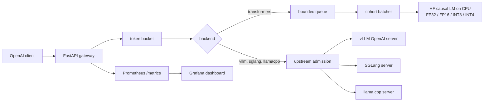

# LLM Inference Platform

OpenAI-compatible inference gateway aimed at Machine Learning Engineer / ML infra interviews. It serves a small instruct model on CPU, with the GPU servers (vLLM, SGLang) and a llama.cpp GGUF server wired in as alternate backends. The interesting part of the CPU path is the scheduler we own: cohort continuous batching, a bounded queue, a token-bucket rate limit, and Prometheus metrics.

This repository was exercised on a 4-core CPU with no GPU. Every number in [bench/RESULTS.md](bench/RESULTS.md) was produced by `bench/quant_bench.py` and `bench/serve_bench.py` on that machine. The vLLM and SGLang services are implemented and declared in Compose, and they were **not** executed here.

## Architecture



| Path | Who batches | What we measured |
| --- | --- | --- |
| `BACKEND=transformers` | This repo. See below. | Latency, TTFT, tokens/s, quantization, batched vs unbatched. |
| `BACKEND=vllm` or `sglang` | The upstream server (paged / continuous batching, CUDA graphs, optional TensorRT-LLM elsewhere). | Not run. No GPU in this environment. |
| `BACKEND=llamacpp` | llama.cpp server (`-np` parallel slots). | Server is defined in Compose. INT4 in the measured table is the in-process weight-only path, not a GGUF run, unless `bench/results/quant.json` says otherwise. |

### Cohort continuous batching

The CPU worker is a single thread. It owns the model.

1. When it is idle it takes one request, then waits up to `MAX_WAIT_MS` so concurrent arrivals share one left-padded prefill.
2. It decodes with a KV cache. A sequence that hits EOS / `<|im_end|>` or its `max_tokens` is removed with `Cache.batch_select_indices`. The rest of the cohort keeps decoding. A short request does not wait for `generate()` of the longest one.
3. Between decode steps, if a slot is free and the **head** of the queue has a prompt that fits in the current cache length, that request is prefilled left-padded to the current length and appended. Admission stays FIFO: a prompt that does not fit blocks the requests behind it.

This is not paged attention. A new prompt longer than the live KV length cannot join until the cohort drains. That limitation is why the vLLM and SGLang backends exist: they do the real iteration-level scheduler. `MAX_BATCH_SIZE=1` turns the CPU scheduler into an unbatched baseline, which is how the comparison is measured.

### Admission, limits, timeouts

- Per-key and global token buckets. Excess requests get HTTP 429 and `Retry-After`.
- The in-process queue is bounded (`MAX_QUEUE_SIZE`). When it is full the gateway returns 503 instead of buffering without limit.
- The proxy path has the same idea: `UPSTREAM_MAX_INFLIGHT` calls in flight, `MAX_QUEUE_SIZE` waiters, then 503.
- `REQUEST_TIMEOUT_S` cancels a request that is still queued or still decoding. The client sees 504.
- `max_tokens` above `MAX_NEW_TOKENS_CAP` is rejected with 400.

### Quantization on CPU

| Mode | What it is |
| --- | --- |
| `fp32` | Checkpoint loaded in float32. Reference for quality and for the `model.generate` cross-check. |
| `fp16` | Full cast to float16. CPU kernels may reject this. The bench records the exception instead of inventing a speedup. |
| `int8` | `torch.ao.quantization.quantize_dynamic` on `nn.Linear`. This is the default serving mode. |
| `int4` | Group-wise symmetric int4 weights, packed 2-per-byte, dequantized to float32 on each forward. `lm_head` stays float. Without an int4 GEMM this is a memory optimization and is often slower. A real int4 speedup on CPU is a GGUF Q4 model under llama.cpp. |

### Metrics

`GET /metrics` exposes, among others:

- `llm_ttft_seconds`, `llm_e2e_latency_seconds` (histograms; Grafana computes p50/p95/p99)
- `llm_tokens_generated_total`, `llm_request_tokens_per_second`
- `llm_queue_depth`, `llm_batch_rows`, `llm_batch_size`, `llm_batch_joins_total`
- `llm_rate_limited_total`, `llm_rejected_total`

Grafana is provisioned from [deploy/grafana/dashboards/llm-inference.json](deploy/grafana/dashboards/llm-inference.json). Anonymous viewers can open it. Admin login is `admin` / `admin`.

## Quickstart

CPU stack. The first start downloads `Qwen/Qwen2.5-0.5B-Instruct` into `./.cache/huggingface` (about 1 GB) and then quantizes it to int8.

```bash
docker compose up --build
```

Gateway: <http://localhost:8000>. Prometheus: <http://localhost:9090>. Grafana: <http://localhost:3000>.

```bash
curl -s http://localhost:8000/health | jq .
curl -s http://localhost:8000/v1/chat/completions \
  -H 'content-type: application/json' \
  -d '{
    "model": "Qwen/Qwen2.5-0.5B-Instruct",
    "messages": [{"role": "user", "content": "What is 17 + 25? Reply with digits only."}],
    "max_tokens": 16,
    "temperature": 0
  }'
```

Streaming is the same body with `"stream": true` (SSE, `data: [DONE]`). `GET /v1/models` lists the one configured model. `POST /v1/completions` accepts a raw prompt.

Without Docker, from a venv that has the CPU torch wheel:

```bash
python -m venv .venv && . .venv/bin/activate
pip install torch --index-url https://download.pytorch.org/whl/cpu
pip install -r requirements.txt
PYTHONPATH=src uvicorn llm_platform.asgi:app --host 0.0.0.0 --port 8000
```

`/health` returns 503 while weights load and 200 after. Tune with the variables in [.env.example](.env.example).

### Tests

```bash
pip install -r requirements-dev.txt
ruff check src tests bench
pytest
```

Unit tests use a fake engine. They do not download a model. CI runs lint, pytest, and `docker build`.

### Load test

With the gateway already up and `ENABLE_ADMIN=true` if you want the harness to flip the batch size:

```bash
PYTHONPATH=src python bench/load_test.py --requests 8 --concurrency 4 --max-tokens 16
QUANTIZATION=int8 PYTHONPATH=src python bench/serve_bench.py
PYTHONPATH=src python bench/quant_bench.py
PYTHONPATH=src python bench/render_report.py
```

`serve_bench.py` starts uvicorn itself, warms up, runs an unbatched pass (`max_batch_size=1`) and a batched pass (`max_batch_size=4`, concurrency 4), and writes `bench/results/batching.json`.

## GPU and llama.cpp

These profiles do not start with a plain `docker compose up`.

```bash
# vLLM. Image tag is pinned; bump it for the driver on the machine you actually have.
BACKEND=vllm UPSTREAM_BASE_URL=http://vllm:8000/v1 \
  docker compose --profile gpu up --build gateway vllm prometheus grafana

# SGLang, same idea, port 30000 inside the network.
BACKEND=sglang UPSTREAM_BASE_URL=http://sglang:30000/v1 \
  docker compose --profile gpu up --build gateway sglang prometheus grafana

# llama.cpp. Put a GGUF at ./models/model.gguf first.
BACKEND=llamacpp UPSTREAM_BASE_URL=http://llamacpp:8080/v1 \
  docker compose --profile llamacpp up --build gateway llamacpp prometheus grafana
```

The gateway still rate-limits, bounds concurrency, times out, and records TTFT from the upstream SSE stream. Batching metrics (`llm_batch_rows`, joins) stay on the in-process scheduler. Upstream batching shows up as tokens/s and latency.

TensorRT-LLM is not a fourth runtime in this repo. The practical GPU path here is vLLM or SGLang, which is what those serving stacks use in place of a hand-rolled TensorRT engine for a 0.5B model. A TensorRT-LLM engine would be another OpenAI-compatible upstream behind the same `BACKEND` switch.

## API surface

| Method | Path | Notes |
| --- | --- | --- |
| `POST` | `/v1/chat/completions` | `stream`, `temperature`, `top_p`, `max_tokens`. `n` must be 1. |
| `POST` | `/v1/completions` | String prompt. |
| `GET` | `/v1/models` | The configured `MODEL_ID`. |
| `GET` | `/health`, `/ready` | 503 while the CPU model is loading. |
| `GET` | `/metrics` | Prometheus. |
| `POST` | `/admin/batching` | Only if `ENABLE_ADMIN=true`. Body: `max_batch_size`, `max_wait_ms`. |

Unknown `model` values return 404. The server does not silently route them at a different checkpoint.

## Design trade-offs

- **One model thread.** A second thread would race the CPU runtime and oversubscribe the 4 cores. Throughput comes from the batch dimension. Horizontal scale means more gateway processes, not more threads in one process.
- **Cohort join, not paged attention.** Implementing PagedAttention on top of a stock HF forward would be a research project and would not be honest about what runs on this CPU. The join rule is small enough to test: a waiting request is admitted only when its prompt fits the live cache, and only from the head of the queue.
- **Left padding and explicit position ids.** Rows in a batch have different prompt lengths. Position ids for real tokens start at 0 on the right edge so RoPE is not shifted by the pad. The cache length is still the padded length, which is what makes a later join possible.
- **INT8 as the default.** Dynamic quantization is the CPU path that actually uses integer GEMM. INT4-without-a-kernel is included because the size/quality comparison is the point, not because it wins on latency.
- **Proxy vs in-process.** vLLM, SGLang, and llama.cpp already speak HTTP and already batch. Reimplementing them in-process would hide the boundary an infra team actually operates: an edge gateway in front of a specialized server.
- **Histograms, not client-side percentiles, in Grafana.** p95 in the dashboard is `histogram_quantile` over the scrape window. The benchmark report uses exact client-side percentiles because a short run has too few samples for a 1-minute rate histogram to be meaningful.

## Measured results

See [bench/RESULTS.md](bench/RESULTS.md) for the host, the quantization table, the greedy text, and the batched vs unbatched load. Those files are the record. If a mode failed (FP16 on CPU is the likely one), the JSON contains the exception string.

Hardware for the committed run is whatever `bench/results/quant.json` records under `host`. It is a CPU-only measurement.

## Resume bullets

Use these only with the numbers from `bench/RESULTS.md` filled in. Do not round them into a different machine.

- Built an OpenAI-compatible inference gateway (FastAPI, SSE streaming) with pluggable backends: an in-process CPU scheduler over Qwen2.5-0.5B and HTTP proxies for vLLM, SGLang, and llama.cpp.
- Implemented cohort continuous batching (shared prefill, KV-cache early exit, FIFO in-flight join) plus token-bucket limits, a bounded queue, and request timeouts. Compared batched and unbatched throughput on a 4-core CPU; figures are in the benchmark report.
- Compared FP32, FP16, dynamic INT8, and weight-only INT4 on resident size, latency, and greedy output agreement, and published a Prometheus/Grafana dashboard for TTFT, latency percentiles, tokens/s, and queue depth.

## Layout

```
src/llm_platform/          gateway, batcher, quantization, engines
bench/                     load test, quant comparison, report renderer
deploy/prometheus          scrape config
deploy/grafana             provisioned datasource and dashboard
docker/Dockerfile.llamacpp CPU llama.cpp server image
tests/                     fake-engine unit tests
```

## Limitations

- No GPU was available, so vLLM, SGLang, and TensorRT-LLM were not benchmarked.
- The in-process int4 path dequantizes every forward. It is not llama.cpp Q4_K_M.
- One replica, no speculative decoding, no prefix cache, no chunked prefill.
- Chat content must be a string. Multi-part content and `n>1` return 400.
- The admin endpoint is off unless `ENABLE_ADMIN=true`. Do not enable it on a shared port.
